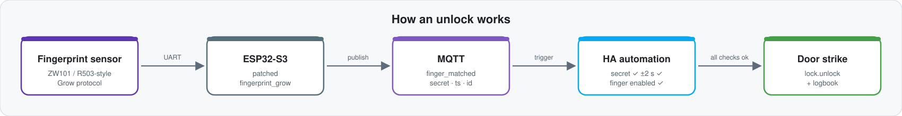
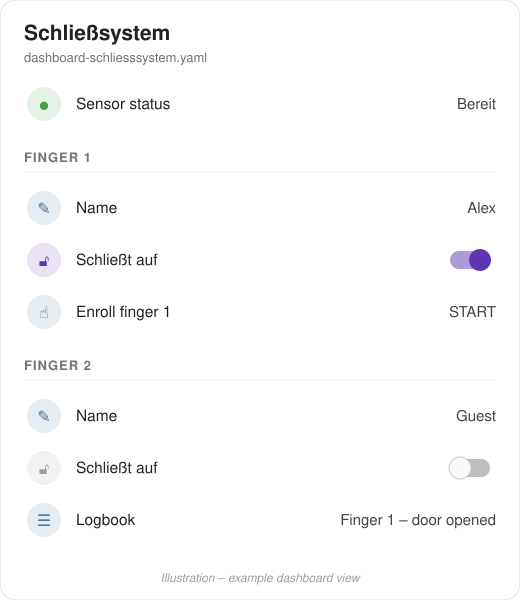

# TouchAssist

[English](README.md) · **Deutsch**


Ein gepatchter `fingerprint_grow`-Baustein für [ESPHome](https://esphome.io/) plus ein komplettes, laufendes Projekt darauf: eine Türklingel mit Fingerabdruckleser bzw. ein Zutrittssystem auf einem ESP32-S3, das per MQTT mit Home Assistant spricht und bei einem verifizierten Treffer einen Türöffner auslöst – inspiriert von [tinytouch](https://github.com/ZimengXiong/tinyTouch).

- [`components/fingerprint_grow/`](components/fingerprint_grow/) – der gepatchte ESPHome-Baustein (direkter Ersatz für den Standard-Baustein über `external_components:`)
- [`esphome/klingel-fingerprint.yaml`](esphome/klingel-fingerprint.yaml) – die komplette Gerätekonfiguration: Anlernen, Erkennen, MQTT-Events, gesicherte Entriegelungs-Nachricht und ein Button-„Assistent“ (funktioniert aus Home Assistant *oder* einem normalen Browser)
- [`home-assistant/`](home-assistant/) – Automationen, Dashboard und Helfer auf HA-Seite, die aus den MQTT-Events ein echtes Türöffnungssystem mit Verwaltungsoberfläche machen

## So funktioniert's





*Illustration – die mitgelieferte Dashboard-Ansicht mit Beispielwerten.*

## Warum es diesen Fork gibt

Der Standard-Baustein `fingerprint_grow` von ESPHome hat bei günstigen Sensor-Klonen im ZW101-Stil mit Grow-Protokoll (wie sie bei AliExpress/Amazon verkauft werden, nicht die offiziell gelisteten R307/R503/ZFM-20) ein paar Schwächen:

1. **Der Start-Handshake gibt zu schnell auf.** Der Standard sendet ~20 ms nach dem Booten einen einzigen Passwort-Handshake und markiert den Sensor dauerhaft als defekt, wenn darauf keine Antwort kommt. Manche Klone brauchen für ihren eigenen Selbsttest länger. Dieser Fork hält `setup()` genauso schnell und nicht blockierend wie der Standard (damit das zeitkritische frühe WLAN-Verbinden nicht leidet), wiederholt den Handshake aber im Hintergrund im normalen ~500-ms-Takt, statt endgültig aufzugeben.
2. **„Hängt nach einem Scan“ beim Anlernen.** Wer den `sensing_pin` (TouchOut) zum Steuern der Abfrage nutzt – empfehlenswert, sonst fragt ESPHome den Sensor für immer alle 500 ms mit einem echten UART-Bildaufnahme-Befehl ab, auch ohne Finger –, bekommt bei manchen Klonen nie zuverlässig „Finger entfernt“ gemeldet, und der Anlern-/Erkennungsablauf bleibt stumm hängen. Dieser Fork ergänzt eine 3-Sekunden-Zwangszeit: Bestätigt der Pin das Entfernen nicht rechtzeitig, gilt der Finger als entfernt und es geht weiter.

Die genauen Änderungen und Gründe stehen in der [Commit-Historie](../../commits/main).

## Hardware

- ESP32-S3 (getestet mit ESP32-S3 DevKitC-1 / „Super Mini“)
- Ein kapazitiver Fingerabdrucksensor im ZW101-Stil mit dem verbreiteten `0xEF01`-„Grow“-Paketprotokoll (dieselbe Familie wie die offiziell gelisteten R307/R503/R503-RGB/ZFM-20, auch wenn upstream nur diese als getestet dokumentiert sind)
- Verkabelung: Sensor-TX/RX → ESP32-UART (GPIO43/GPIO44 in der Beispielkonfiguration, an dein Board anpassen), VCC/GND an eine stabile 3,3-V-Schiene. Die allgemeine Pinbelegung zeigt die [Verdrahtungstabelle von tinytouch](https://github.com/ZimengXiong/tinyTouch/blob/main/docs/customer/build.md).
- **`sensing_pin` (TouchOut) wird bewusst *nicht* genutzt** – beim Testgerät meldete er dauerhaft „Finger liegt auf“, auch Sekunden nachdem kein Finger mehr in der Nähe war. Auch der Treiber von tinytouch nennt diesen Pin „nicht zuverlässig genug“. Ohne ihn fragt ESPHome im `update_interval` (Standard 500 ms) per echtem UART-Befehl ab – zuverlässig, aber mit ständigem UART-Verkehr.
- **Bekannte Hardware-Grenze:** Die Befehle `aura_led_control`/`led_control` für den LED-Ring bestätigt der Sensor mit `OK` (im DEBUG-Log nachweisbar), die LED bleibt aber bei diesem Gerät immer auf „blau atmend“ – egal welcher Zustand/welche Farbe gesendet wird. Das sieht nach einer Firmware-/Hardware-Grenze dieses günstigen Klons aus, nicht nach etwas, das sich vom ESP32 aus beheben lässt.

## Einrichtung

### 1. Secrets

In die `secrets.yaml` von ESPHome (neben `wifi_ssid_*`/`wifi_password_*`, `mqtt_broker`/`mqtt_username`/`mqtt_password`, `ota_password`):

```yaml
fingerprint_unlock_secret: "<zufälliges Token – erzeugen mit:
  python3 -c 'import secrets; print(secrets.token_hex(24))'>"
```

Dieses Token steckt in der MQTT-Nachricht `finger_matched` und wird von der HA-Automation geprüft, bevor irgendetwas aufgeschlossen wird – siehe [Sicherheitsmodell](#sicherheitsmodell).

### 2. Gerät flashen

[`esphome/klingel-fingerprint.yaml`](esphome/klingel-fingerprint.yaml) direkt verwenden oder in die eigene ESPHome-Konfiguration übernehmen und Board/Pins/Entitätsnamen anpassen. Dieses Repo wird automatisch über `external_components:` eingebunden.

### 3. Home Assistant

1. Die 10 Helfer aus [`home-assistant/helpers.md`](home-assistant/helpers.md) anlegen (ein Name und ein Freigabe-Schalter pro angelerntem Finger-Slot).
2. [`home-assistant/automation-tuer-entriegeln.yaml`](home-assistant/automation-tuer-entriegeln.yaml) und [`home-assistant/automation-logbuch-ohne-treffer.yaml`](home-assistant/automation-logbuch-ohne-treffer.yaml) importieren (in den YAML-Editor einer Automation einfügen). **`REPLACE_WITH_YOUR_SECRET`** durch exakt den Wert aus der `secrets.yaml` ersetzen und `lock.haustueroeffner` sowie das Push-Skript der Automation durch deine eigenen Entitäten ersetzen.
3. [`home-assistant/dashboard-schliesssystem.yaml`](home-assistant/dashboard-schliesssystem.yaml) als neue Dashboard-Ansicht einfügen – mit Anlern-Buttons pro Finger, Name/Freigabe-Schaltern, Sensorstatus und einem Logbuch der Zutrittsversuche. Entity-IDs anpassen, falls du etwas umbenannt hast.
4. Einen Finger im Dashboard anlernen, prüfen, ob er im Logbuch richtig erscheint, seinen Schalter „Schließt auf“ einschalten und **erst wenn du dem Ganzen vertraust** in der Entriegelungs-Automation bei `lock.unlock` `enabled: false` entfernen (wird absichtlich deaktiviert ausgeliefert – als Sicherheitsnetz für eine neue Automation, die eine echte Tür steuert).

## Sicherheitsmodell

Die MQTT-Nachricht `finger_matched` enthält drei Felder, die die Automation der Reihe nach prüft, bevor sie aufschließt – jeder Fehlschlag landet mit konkretem Grund im HA-Logbuch, statt still nichts zu tun:

1. **Gemeinsames Geheimnis** – ein zufälliges Token in der Nachricht. Ohne es könnte alles, was auf das MQTT-Topic des Sensors veröffentlichen darf (z. B. ein anderes Gerät mit denselben Broker-Zugangsdaten), einen Treffer fälschen. Das ist ein Klartextfeld, keine Verschlüsselung – es stoppt gefälschte oder versehentliche Nachrichten, nicht das Mitschneiden und Wiederabspielen einer echten.
2. **Zeitstempel (± 2 Sekunden)** – ein Unix-Zeitstempel aus der per SNTP gestellten Uhr des ESP32. Alles, was nicht in den letzten Sekunden gesendet wurde, wird abgelehnt – eine mitgeschnittene und später abgespielte *echte* Nachricht ist also fast sofort ungültig.
3. **Freigabe pro Finger** – auch ein gültiger, frischer, korrekt erkannter Scan wird abgelehnt, wenn `input_boolean.fingerabdruck_finger_<N>_aufschliessen_aktiv` aus ist.

**Wogegen das *nicht* schützt:** einen Angreifer, der in Echtzeit mitschneidet und innerhalb der 2 Sekunden erneut veröffentlicht, oder jemanden mit den MQTT-Zugangsdaten genau *dieses* Geräts. Dafür MQTT über TLS und Broker-ACLs einrichten, die den Topic-Baum `esp_home/fingerprint/#` auf den MQTT-Login dieses Geräts beschränken – das muss am Broker passieren, außerhalb dieses Repos.

## Fehlersuche

| Problem | Lösung |
|---|---|
| Sensor wird nach dem Start nie bereit | Verkabelung und 3,3-V-Versorgung prüfen; dieser Fork wiederholt den Handshake alle ~500 ms – im ESPHome-Log nach `fingerprint_grow` suchen. |
| Logbuch: „verdächtiger Freischalt-Versuch abgelehnt“ | Token- oder Zeitstempel-Prüfung fehlgeschlagen: `fingerprint_unlock_secret` und `REPLACE_WITH_YOUR_SECRET` müssen identisch sein, und die ESP32-Uhr muss per SNTP gestellt sein (`time:` in der Gerätekonfiguration). |
| Logbuch: „Erkennungssicherheit zu niedrig“ | Finger neu anlernen, Sensor sauber halten, Finger flach auflegen. |
| Logbuch: „für die Türöffnung deaktiviert“ | Schalter „Schließt auf“ dieses Fingers einschalten. |
| Treffer im Logbuch, Tür bleibt zu | Die Entriegelung wird mit `enabled: false` ausgeliefert – einschalten, sobald du dem Aufbau vertraust. |

## Lizenz

Wie ESPHome upstream (`components/`) – dies ist ein Fork/Patch, keine Neuentwicklung.
